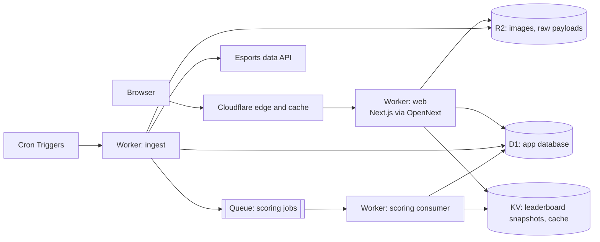

# cs-vv-fantasy: Product and Technical Plan

| | |
|---|---|
| Project name | cs-vv-fantasy |
| Status | Draft v0.2 (decisions from 2026-10-29 review applied, see section 13) |
| Date | 2026-10-29 |
| Scope | MVP (free-to-play) and Phase 2 (payments, custom domain) |
| Stack | Next.js on Cloudflare Workers (OpenNext), D1, KV, R2, Queues, Cron Triggers |
| Hosting (MVP) | Cloudflare `workers.dev` subdomain; custom domain in the next phase |

---

## 1. Summary

A tournament-based fantasy game for professional Counter-Strike 2.

For each supported tournament, a user builds a roster of 5 pro players under a budget. The user gives each player a role (a scoring booster). Players earn fantasy points from their real per-map stats. Users compete on a global leaderboard and in private leagues.

- **MVP:** free to play, no prizes, no payments.
- **Phase 2:** payments in USD (cards) and crypto, for premium features and, only after legal review, paid contests.

**Reference product.** HLTV Fantasy (for example `hltv.org/fantasy/670/overview`) is the structural reference: salary cap, roles, per-map scoring, stages, leagues. We build our own ruleset, role names, point values, UI and brand. We do not copy HLTV text, design or branding.

---

## 2. Goals and non-goals

### MVP goals

1. One fantasy game per supported tier-1 tournament (Majors, IEM, BLAST, ESL Pro League, PGL and similar).
2. Users can sign up, build a team, assign roles, follow points live, and compete on leaderboards and in private leagues.
3. Data ingestion and scoring run automatically. An admin can correct data and re-score.
4. The platform runs at very low cost: about $64/month at launch (Workers Paid plan $5 + Cito Pro $59), plus usage above the included limits.
5. **Every game number is configurable in the admin panel** (points, roles, budget, roster rules, map-count mode, transfers, pricing, leagues). No game number is hard-coded. We tune without a deploy (section 7.1).
6. English only at launch, but every user-facing string lives in one strings file per language, so adding a language means adding one file (section 5.7).
7. Sign-in with email and password only. Google and Steam sign-in come later.

### MVP non-goals

- Payments, prizes, wallets.
- Native mobile apps (the web app is mobile-first and responsive).
- Draft mode, pick'em predictions, chat.
- Live push over WebSockets (polling is enough for MVP).
- Seasonal leaderboards across tournaments (planned for after launch).

---

## 3. Game design (ruleset v1 draft)

All numbers below are **default values only**. Every one of them is a field in the game config, which the admin edits in the admin panel (section 7.1). We tune the defaults with a backtest on past tournaments before launch.

### 3.0 Reference mechanics (research, October 2026)

How existing games do it. We use this to understand the genre, not to copy.

| Mechanic | HLTV Fantasy (2026) | DraftKings CS2 (DFS) | Our v1 |
|---|---|---|---|
| Roster and budget | 5 players, $1,000,000, max 2 per real team | 6 players, $50k cap | 5 players, 100.0 credits, max 2 per real team |
| Scoring unit | Per series | Per map stats | Per map stats |
| Base points | (Rating 3.0 − 1.00) × 50; team win +6, loss −3 | Kill +1.5, assist +1, death −1, entry +0.5, clutch +1 to +5, quad +3, ace +5 | Section 3.4 |
| Roles | 12 roles, one per player, fixed for the game. Each role uses a per-round threshold: +5 max, +2 small, −2 fail | None | 8 roles with per-event bonuses (section 3.5) |
| One-time boosters | 18 boosters, +5 if the condition triggers, once per game, one match | None | Not in MVP (backlog: power-ups) |
| Captain | None | ×1.5 | None (dropped in review) |
| Format | BO1 points halved; teams with a bye are "padded" with their average | Not applicable | Byes padded (section 3.8); map-count mode is a config setting (section 3.4) |
| Stages | Each stage is a separate game with its own team | Single slate | Stages inside one game, free rebuild between stages |
| Pricing | LAN rating over 6 months + team ranking, editor tweaks; a stand-in gets the price of the player he replaces | Set per slate | VRS ranking + form, admin review (section 3.6) |
| Other modes | Live snake draft leagues (unique ownership); season points by percentile finish; $10k per season in prizes | Paid contests | Backlog (section 11.1) |

Takeaways:

- Scoring on rating alone (HLTV) is simple, but it needs a licensed rating. Scoring on raw stats (DraftKings) works with any provider that has the stats. We use raw stats plus a rating bonus.
- The map-count problem is real: a 2–1 series gives 3 maps of points, a 2–0 series gives 2. HLTV solves it by scoring per series and halving BO1. Sleeper scores maps 1–2 only. We make it a config setting (section 3.4) and pick the default with the M0 backtest.
- Byes in Swiss and playoff formats need padding, or seeded teams are a bad pick.

### 3.1 Core loop

1. Admin publishes a fantasy game for a tournament, with the player pool and prices.
2. The user builds a team before the stage locks.
3. Matches are played. Points update after each map.
4. Between stages, the user gets a transfer window.
5. The tournament ends. Standings are final 48 hours after the last map (time for stat corrections).

### 3.2 Team rules

| Rule | Value (v1) |
|---|---|
| Roster size | 5 players |
| Budget | 100.0 credits |
| Player price range | 12.0 to 26.0 credits, in 0.5 steps |
| Max players from one real team | 2 |
| Roles | Each player gets exactly 1 role. Each role is used at most once per roster. |
| Teams per user per tournament | 1 |

An average slot is 20.0 credits, so a user cannot pick only stars. This is the main skill trade-off.

### 3.3 Stages, locks and transfers

- A tournament is an ordered list of **stages** (for example: Swiss stage, Playoffs; a Major has Stage 1, Stage 2, Stage 3, Playoffs). Stages are generic, so any format works.
- Each stage has a **lock time**: the earlier of the first scheduled match start and the first time we detect a live match in that stage. After lock, the roster cannot change until the stage ends.
- Points from all stages add up to the tournament total.
- **Transfer window between stages (default: free rebuild).** The user can change any players and roles. Prices are recalculated for the new stage. The new roster must fit the budget at the new prices.
- If the user does nothing, the roster carries over unchanged (even if it is over budget at the new prices). Players from eliminated teams score 0.
- A user can join late. Stages that locked before they joined score 0.
- The transfer mode is a config setting: `free_rebuild` (default) or `limited` (N free transfers, then a points penalty per extra transfer; N and the penalty are config values).

### 3.4 Scoring (per player, per map)

Base points:

| Event | Points |
|---|---|
| Kill | +2 |
| Death | -1 |
| Assist | +1 |
| Opening kill (first kill of the round) | +2 |
| Opening death | -1 |
| 3-kill round (needs per-map multi-kill data) | +2 |
| 4-kill round (needs per-map multi-kill data) | +4 |
| 5-kill round, ace (needs per-map multi-kill data) | +8 |
| Clutch won, 1vX (needs per-map clutch data) | +2 per opponent (1v1 = +2, 1v3 = +6) |
| ADR 100 or more | +3 |
| ADR 85 to 99 | +1 |
| Rating 1.50 or more | +6 |
| Rating 1.30 to 1.49 | +4 |
| Rating 1.15 to 1.29 | +2 |
| Rating 0.70 to 0.84 | -2 |
| Rating below 0.70 | -4 |
| Team wins the map | +3 |
| Team wins the series (given once, on the last map) | +2 |

Example: a solid map (20 kills, 16 deaths, 5 assists, 3 opening kills, 2 opening deaths, one 3k, one 1v1 clutch, ADR 85, rating 1.15, map won) scores about 43 points. A star map (30 kills, 12 deaths) scores about 75. A bad map (10 kills, 20 deaths) scores about 0.

Rules and notes:

- The MVP provider (Cito, section 4.2) has no per-map multi-kill or clutch data. Those lines are off in the MVP rules config. They switch on when a provider gives the data. The examples above include them; without them, the solid map scores about 39.
- "Rating" is the per-map rating from the data provider. If the provider has no rating, we compute our own performance rating from KPR, DPR, ADR, KAST and impact stats (formula decided in the data spike, M0). We do not claim it is the HLTV rating.
- A player who does not play a map scores 0 for that map.
- Forfeited or technical-loss maps give no points to anyone.
- Every point value, threshold and on/off switch in the table above is a config field.

**Map-count mode (config setting).** A 2–1 series gives 3 maps of points and a 2–0 series gives 2. The admin picks how map points become match points:

| Mode | Match points | Notes |
|---|---|---|
| `sum` | Sum of all map points | DraftKings style. Players in long series get more points. |
| `average_x_factor` (proposed default) | Average map points × format factor | Format factors are config values. Defaults: BO1 ×1, BO3 ×2, BO5 ×3. Removes the 2–0 vs 2–1 luck. |

The admin can change the mode and the factors per tournament. The M0 backtest confirms the default.
- Overtime maps are not normalized in v1. Revisit after the backtest.

### 3.5 Roles (boosters)

Each player in the roster gets one role. The role adds a bonus on every map that player plays. The user picks 5 different roles from the roles that are available. Each role targets roughly +3 to +6 points per average map. We balance them with the backtest so no role is always the best choice.

| Role | Bonus per map | Required stat | In MVP (Cito data) |
|---|---|---|---|
| Spearhead | +2 per opening kill, and opening deaths cost 0 | Opening kills and deaths | Yes |
| Sharpshooter | +0.5 per headshot kill | Headshot kills | Yes |
| Anchor | KAST 80% or more: +4; 70% to 79%: +2 | KAST | Yes |
| Workhorse | +1 per 10 ADR above 70 (ADR 95 gives +2.5) | ADR | Yes |
| Survivor | +0.25 per round survived (rounds played − deaths) | Deaths, rounds | Yes |
| Enabler | +1 per assist (+1 per flash assist when available) | Assists, flash assists | Yes (assists only) |
| Underdog | +4 if the player's team wins the map against a higher-ranked team | Team ranking (Valve VRS) | Yes |
| Sniper | +1 per AWP kill | Kills by weapon | No: needs per-map AWP kills |
| Closer | +3 per clutch won (on top of base clutch points) | Clutches | No: needs per-map clutches |
| Rampage | Multi-kill round bonuses are doubled | Multi-kill rounds | No: needs per-map multi-kills |

A role whose stat is missing is not offered. The MVP has 7 roles, so a roster of 5 still has a real choice.

### 3.6 Player pricing

- **Initial price** comes from a formula that the admin reviews before publishing:
  - team strength from the Valve Regional Standings (VRS), which Valve publishes on GitHub;
  - individual form: average rating and average fantasy points over the last 90 days;
  - clamp to 12.0 to 26.0 and round to 0.5.
- **Between stages**, prices are recalculated with the player's fantasy points in this tournament (for example, a weighted move of up to ±2.0 credits).
- The admin can override any price. All price changes are stored (price history is shown on the player page).

### 3.7 Leagues and leaderboards

- **Global leaderboard** per tournament, plus a leaderboard per stage.
- **Private leagues:** created by any user, joined by invite code or link. The creator can remove members. Limit: 500 members per league, 20 leagues per user (v1).
- **Ties:** equal points share the same rank. For display order, we use more points in the latest stage, then the earlier final roster save.
- **Profile:** history of the user's teams and final ranks per tournament.

### 3.8 Edge cases

| Case | Handling |
|---|---|
| Stand-in replaces a player | The stand-in is a separate player. Admin adds the stand-in to the pool at the replaced player's price; they can be picked in the next transfer window. The original player scores 0 for maps they do not play. |
| Team has a bye (for example, seeded straight to a later playoff round) | Padding: for each skipped match, the player gets their average match points in this stage. Otherwise seeded teams are a bad pick. |
| BO1 vs BO3 vs BO5 | Handled by the map-count mode setting (section 3.4). |
| Match rescheduled | Stage lock time does not move. |
| Provider corrects stats | Re-score the affected maps (scoring is idempotent). Leaderboards update. Standings freeze 48 hours after the tournament ends. |
| Player changes team mid-tournament | Rare. Admin handles it manually. |
| Provider outage during a live match | Points update late. Admin can enter or correct stats by hand. The UI shows "data delayed". |

---

## 4. Data provider

### 4.1 Requirements

| Need | Priority |
|---|---|
| Tournaments, stages, brackets | Must |
| Teams, rosters, players (stable IDs) | Must |
| Match schedule, BO format, live status | Must |
| Per-map result and score | Must |
| Per-player per-map: kills, deaths, assists, ADR, KAST, headshots, rating | Must |
| Per-player per-map: opening kills/deaths, multi-kill rounds, clutches, AWP kills, flash assists | Should (needed for roles) |
| Update within a few minutes after a map ends | Must |
| Live (round-by-round) updates, webhooks | Nice to have |
| Player photos, team logos with usage rights | Nice to have |
| Commercial use allowed, including a future paid product | Must |

### 4.2 Provider comparison (research, October 2026)

Who owns CS2 data: ESL FACEIT Group (IEM, ESL Pro League, many Majors) has an exclusive data deal with GRID. BLAST data is exclusive on GRID for betting and prediction markets. PGL and StarLadder data rights are with Oddin.gg (2024 to 2026). GRID bought the assets of Bayes Esports after its 2025 insolvency. So "official" tier-1 data means GRID and Oddin.gg, both enterprise and custom-priced.

| Provider | Price | Per-map player stats | Live / push | Commercial terms | Notes |
|---|---|---|---|---|---|
| **Cito** (citoapi.com) | Free: 500 calls/month, 60 s delay. Starter $15 (10k calls). Pro $59 (250k calls, real-time, full archive). Scale $100 (1M calls, WebSockets) | K, D, A, ADR, KAST, headshots, opening kills and deaths, CT/T splits, own rating (`cito_rating_1`). **Missing per map:** multi-kills, AWP kills, flash assists, clutches, utility damage | SSE on all plans; HMAC-signed webhooks from Pro | Use in own product allowed with attribution; no resale. States it is "not betting-grade or rights-cleared" | About 159 CS2 endpoints (events, brackets, vetoes, rosters with photos, VRS). Operator not named; domain registered 2026-01-14; CS2 marked beta; IDs match HLTV IDs, so the data is likely scraped from HLTV. Tier-1 coverage not verified |
| **PandaScore** | Free: 1,000 requests/hour (schedules, results, rosters, live status). Historical from about €400 per game per month. Live from about €1,000 per game per month | Paid only. Historical: K, D, A, ADR, KAST, headshots, flash assists, rating. First kills, multi-kills, clutches: Live Pro only (quote) | WebSocket on Live plans | Stats plans only for non-betting use; paid-entry fantasy needs a custom agreement | Established, good docs. Free tier is useful as a backup for schedules and results |
| **GRID** | Custom | Full, official, rights-cleared, under 200 ms | Yes | Official licensing | Covers IEM, ESL Pro League, Majors run by ESL FACEIT Group, BLAST, CCT. The free "Open Access" program seems retired (page redirects to /plans); ask GRID |
| **Oddin.gg** | Custom | Official for PGL and StarLadder | Yes | Betting-focused B2B | Needed for full tier-1 coverage at scale |
| **Abios (Kambi)** | Custom, 14-day trial | Match and play-by-play tiers | Yes | Sales-led | Its official CS2 feed came through Bayes; current rights unclear |
| **Liquipedia** | MediaWiki API free (1 request per 2 s). DB API by approval; free only for non-commercial use | No reliable per-player stats | No | CC-BY-SA 3.0, attribution required | Good backup for brackets, rosters, team pages |
| **Own demo parsing** (awpy, demoinfocs-golang, MIT) | Infrastructure cost only | Everything, including multi-kills, clutches, AWP kills, utility | Hours after the match (demo upload) | Grey: tournament organizers own data rights; pro demos are mostly on HLTV | Demos are hundreds of MB. Needs a container or VM, not a Worker |
| **HLTV** | No API | — | — | Scraping is against its terms; Cloudflare blocks bots | Owned by Better Collective and runs a competing fantasy game. **Do not scrape.** |
| Not viable | — | — | — | — | Bayes (insolvent 2025), SportsDataIO esports (pages gone), SportDevs (domain does not resolve), FACEIT Data API (only FACEIT platform matches), bo3.gg (no public API) |

**Recommendation:**

1. **MVP primary: Cito.** It is the only cheap source with per-map ADR, KAST, opening kills, rating, brackets, photos and webhooks. Start on Starter ($15) during development and move to Pro ($59) for launch, which adds real-time data and webhooks.
2. **MVP scoring uses only the fields Cito has** (see sections 3.4 and 3.5). Rules that need multi-kills, clutches, AWP kills or flash assists stay disabled until a provider gives them.
3. **Backup:** PandaScore Free for schedules, results and rosters, and Liquipedia (with attribution) for brackets. If Cito fails during a live event, the admin can enter stats by hand.
4. **Before Phase 2 paid contests: move to official data.** That means GRID (ESL FACEIT Group events, BLAST), plus Oddin.gg for PGL and StarLadder, or a PandaScore Live Pro agreement that allows paid fantasy. Start these sales talks early, because every contract is custom.
5. **Risk to accept for the MVP:** Cito's operator is anonymous and its data is likely scraped from HLTV. Our provider adapter, own database and raw archive in R2 keep us independent of Cito.

### 4.3 Integration design (provider-independent)

We will likely change or add providers. The code must not depend on one provider.

- A `DataProvider` interface in `packages/providers` with methods such as `listTournaments`, `getTournament`, `listMatches`, `getMatch`, `getMapStats`.
- One adapter per provider. Each adapter maps the provider response to our internal model.
- An `external_ids` table maps `(provider, provider_id)` to our internal ID for every entity. Switching providers means re-mapping IDs, not migrating data.
- Every raw provider response is stored in R2 (`raw/{provider}/{entity}/{id}/{timestamp}.json`). This allows replay, debugging, and the scoring backtest.
- A nightly reconciliation job re-fetches finished matches of the last 7 days and re-scores if stats changed.

### 4.4 Data spike (milestone M0)

Before we commit to a provider:

1. Get trial or free keys from the top 2 candidates.
2. Pull one finished tier-1 tournament from each.
3. Check every field from 4.1 against the real response.
4. Compute fantasy points with the draft rules. Compare results between providers.
5. Measure the delay between a map ending and stats being available.
6. Read the terms of service for fantasy use and for future paid use.

Output: a short decision record in `docs/decisions/`.

---

## 5. Architecture

### 5.1 Overview



### 5.2 Components

| Component | Technology | Notes |
|---|---|---|
| Web app (UI and API) | Next.js 16 App Router, React Server Components, Server Actions | Deployed to Workers with `@opennextjs/cloudflare`. Uses the Node.js runtime, not the Edge runtime. |
| Ingest worker | Separate Worker, TypeScript, Cron Triggers | Polls the provider. Keeps heavy work out of the web request path. |
| Scoring worker | Queue consumer | Computes points, totals and ranks. Up to 15 minutes CPU per invocation for queue consumers. |
| Database | Cloudflare D1 (SQLite) with Drizzle ORM | 10 GB per database on the paid plan. Migrations with `drizzle-kit` and `wrangler d1 migrations`. |
| Cache | KV and the Workers Cache API | Leaderboard pages, player lists, tournament pages. |
| Object storage | R2 | Raw provider payloads, team logos, player photos. |
| Auth | Better Auth with the Drizzle adapter on D1 | MVP: email and password only (`emailAndPassword`), with email verification and password reset. Later: Google, maybe Steam (good fit for the CS audience). Better Auth adds these as providers without schema rework. |
| Bot protection | Cloudflare Turnstile, Workers rate limiting | On sign-up, login and team save. |
| Email | Resend (or similar) | Email verification, password reset, lock reminders. |
| Monitoring | Workers Logs, Sentry (`@sentry/cloudflare`) | Alert if a match is live but no stats arrive for 10 minutes. |
| Analytics | Cloudflare Web Analytics | No cookies, so a simpler consent banner. |

Known OpenNext limitation: Next.js Node.js middleware (introduced in 15.2) is not supported on Workers. Use standard middleware or checks in route handlers and layouts.

### 5.3 Repository layout (monorepo, pnpm workspaces)

```
apps/
  web/            Next.js app (OpenNext, wrangler config)
    i18n/
      strings_en.json   All user-facing strings (English); one file per language
  worker/         Ingest cron + scoring queue consumer
packages/
  db/             Drizzle schema, migrations, typed queries
  scoring/        Pure scoring engine + rules config + tests
  providers/      DataProvider interface + adapters
  shared/         Types, zod schemas, constants
docs/
  PLAN.md
  decisions/      Architecture decision records
```

The web app and the worker share `packages/db` and `packages/scoring`, so both use the same schema and rules.

### 5.4 Data flow

1. **Schedule sync** (every 6 hours): tournaments, stages, teams, rosters, matches.
2. **Live loop** (cron every minute): if no match is live or starts within 15 minutes, exit at once (cheap). Otherwise fetch live and recently finished matches.
3. For each finished or updated map: store the raw payload in R2, upsert `maps` and `player_map_stats`, and send a `score-map` job to the queue.
4. **Scoring consumer:** compute `player_map_points` (with breakdown) for every player of that map and every role. Then recompute totals of the affected fantasy teams, rebuild the rank snapshot, and write leaderboard pages to KV.
5. **Web:** reads leaderboards from KV and the rest from D1. The client polls every 30 to 60 seconds while a match is live.
6. **Nightly reconciliation:** re-fetch the last 7 days of finished matches and re-score on change.

### 5.5 Scale and limits

- Points are stored per player per map per role, not per fantasy team per map. A fantasy team total is a sum over its 5 picks. This keeps writes small: one map creates about 10 players × 8 roles = 80 rows.
- Rough storage: 100k users × 20 tournaments per year × (1 team + 5 picks) is about 12M rows per year. This fits in D1's 10 GB per database.
- Ranking 100k teams with SQL window functions in the scoring consumer is acceptable. If we grow much beyond that, options are: sharding by tournament (one D1 database per season), or Postgres through Hyperdrive.
- D1 read replication can reduce read latency for users far from the primary region.

### 5.6 Environments and delivery

- Environments: local (wrangler with local D1), staging, production. Each has its own D1, KV, R2 and Queue.
- Git flow: commit and push directly to `main` (no pull requests for now).
- CI (GitHub Actions) on every push to `main`: lint, typecheck, unit tests (Vitest, `@cloudflare/vitest-pool-workers` for worker code), apply D1 migrations, `wrangler deploy`.
- Optional preview deployments per branch (Workers preview URLs) against the staging database.
- Backups: D1 Time Travel (30 days on the paid plan) and a weekly export to R2.

### 5.7 Localization (i18n)

English only at launch. The code is ready for more languages from day one.

**Rule: no user-facing text in components.** Every string the user can see is a key in one strings file per language:

```
apps/web/i18n/strings_en.json    English (source of truth)
apps/web/i18n/strings_ru.json    Example of a later language: copy strings_en.json and translate the values
```

- Library: `next-intl` (works with the App Router and Server Components).
- Keys are grouped by page or feature, for example `teamBuilder.budgetLeft`, `roles.spearhead.name`, `roles.spearhead.description`.
- Plurals and variables use ICU message format, for example `"{count, plural, one {# transfer} other {# transfers}}"`.
- Dates, times, numbers and credits are formatted with `Intl` for the active locale, never by hand.
- Game content shown to users (role names, role descriptions, scoring rule labels, error messages, emails) also uses keys. The admin config stores numbers, not text.
- A CI check fails if a key exists in `strings_en.json` but is missing in another language file, or if a component uses a key that does not exist.
- Adding a language: add `strings_<code>.json`, add the code to the locale list, done.

### 5.8 Hosting and domain

- MVP: deploy to the Cloudflare `workers.dev` subdomain, for example `cs-vv-fantasy.<account>.workers.dev` (staging: `cs-vv-fantasy-staging.<account>.workers.dev`).
- The public URL is an environment variable (`APP_URL`), used by Better Auth, emails and links. Moving to a custom domain later means: add the domain to Cloudflare, attach it to the Worker as a Custom Domain, change `APP_URL`. No code changes.

---

## 6. Data model (draft)

```
users                (Better Auth tables: user, session, account, verification)
profiles             user_id, display_name, country, created_at

tournaments          id, name, tier, starts_at, ends_at, status, game_config_id
stages               id, tournament_id, order, name, format, lock_at, status
teams                id, name, short_name, logo_key, vrs_rank
players              id, nickname, real_name, country, photo_key
team_rosters         team_id, player_id, from, to
tournament_teams     tournament_id, team_id, eliminated_at_stage_id
pool_players         tournament_id, stage_id, player_id, team_id, price, is_available
price_history        pool_player_id, old_price, new_price, reason, changed_by, at

matches              id, tournament_id, stage_id, team_a_id, team_b_id, best_of,
                     scheduled_at, started_at, status, winner_team_id
maps                 id, match_id, order, map_name, score_a, score_b, rounds,
                     winner_team_id, status, is_forfeit
player_map_stats     map_id, player_id, team_id, kills, deaths, assists, hs_kills,
                     adr, kast, rating, opening_kills, opening_deaths,
                     k3, k4, k5, clutches_won (json by 1vX), awp_kills,
                     flash_assists, source_version

game_configs         id, scope ('default' | tournament_id), version, config_json,
                     status ('draft' | 'active' | 'archived'), created_by, created_at
player_map_points    map_id, player_id, role (null = no role), points, breakdown_json, config_version

fantasy_teams        id, user_id, tournament_id, name, created_at
fantasy_rosters      fantasy_team_id, stage_id, saved_at, is_locked
fantasy_picks        roster_id, player_id, role, price_at_pick
fantasy_stage_scores fantasy_team_id, stage_id, points, rank, updated_at
fantasy_totals       fantasy_team_id, tournament_id, points, rank, updated_at

leagues              id, tournament_id (null = all tournaments), name, owner_id, invite_code, max_members
league_members       league_id, user_id, joined_at

external_ids         entity_type, internal_id, provider, provider_id
ingest_runs          id, kind, started_at, finished_at, status, error
audit_log            actor_id, action, entity_type, entity_id, diff_json, at
```

Rules:

- All money-like values (credits now, real money in Phase 2) are stored as integers (credits × 10, cents, or token base units). Never floats.
- All team-building rules (budget, max players per real team, unique roles, lock time) are validated on the server in one place, with the values from the active game config. The client only mirrors them for UX.
- Lock is enforced by server time, never client time.

---

## 7. Scoring engine

- Pure TypeScript functions in `packages/scoring`:
  `scoreMap(stats, role, config) → { points, breakdown[] }` and
  `scoreMatch(mapScores, bestOf, config) → { points, breakdown[] }` (applies the map-count mode).
- The engine reads every number from the game config (section 7.1). It contains no hard-coded point values.
- Deterministic and idempotent: the same input always gives the same output, so re-scoring after a stat correction is safe.
- The breakdown is stored and shown to users, for example "Kills 20 × 2 = 40".
- **Backtest harness:** replay raw stats of the last 5 to 10 tier-1 tournaments (from R2) to tune points. Targets:
  - each role gives a similar average bonus;
  - price correlates with points, but cheap players can still win a stage;
  - the score spread between good and bad maps is wide enough to matter.
- Golden tests: fixed stat fixtures with expected points for every rule and role.

### 7.1 Game config and admin config page

**Rule: no game number is hard-coded.** Points, thresholds, budgets, limits, multipliers and modes come from the game config. The admin edits all of them in the admin panel.

What the config contains (each item is editable):

| Group | Fields (defaults in section 3) |
|---|---|
| Roster | roster size, budget, min and max price, price step, max players from one real team, roles per player, can roles repeat |
| Scoring: base | points per kill, death, assist, opening kill, opening death, headshot; multi-kill points (3k, 4k, 5k); clutch points per opponent; ADR tiers (threshold → points); rating tiers (threshold → points); map win; series win. Each line has an on/off switch |
| Scoring: format | map-count mode (`sum` or `average_x_factor`); format factors for BO1, BO3, BO5; bye padding on/off |
| Roles | for each role: enabled, bonus values, thresholds. Role names and descriptions come from the strings file (section 5.7) |
| Stages and transfers | lock rule (first scheduled match or first live match), transfer mode (`free_rebuild` or `limited`), free transfers, penalty per extra transfer, carry-over of rosters |
| Pricing | weights of team ranking and player form, form window (days), max price change between stages |
| Leagues | max members per league, max leagues per user |
| Standings | hours until standings are final, tie-break order |

How it works:

- **Two levels.** A global default config, and a per-tournament config copied from the default when the tournament is created. The admin can change either.
- **Versions.** Every save creates a new version with author and time (`game_configs`, `audit_log`). Old versions are kept and can be restored.
- **Draft and activate.** The admin edits a draft, sees a validation result (zod schema: types, ranges, required fields), and then activates it.
- **Preview before activate.** The page shows how the change moves points: it re-scores a sample of finished maps with the draft config and shows old vs new points for the top players.
- **Change during a live tournament.** Allowed, with a warning. Activation triggers a full re-score of the tournament through the queue, and leaderboards update. The change is logged.
- **Editor UI.** Forms grouped as in the table above, with the default value and the current value side by side. An "advanced" tab shows the raw JSON for import and export (for example, to copy a config between tournaments).
- **Access.** Only users with the `admin` role. Every change goes to `audit_log`.

---

## 8. Pages (MVP)

| Page | Purpose |
|---|---|
| Home | Current and upcoming fantasy tournaments, the user's active teams |
| Tournament overview | Stages, lock countdown, top players, top users, rules summary |
| Team builder | Player list with filters (team, price, role stats), budget bar, role selection |
| My team (live) | Points per player per map with breakdown, live match status |
| Leaderboards | Global, per stage, per league; search for a user |
| Leagues | Create, join by code or link, members, league table |
| Player page | Stats, price history, fantasy points per map |
| Profile | Team history, final ranks |
| Rules and FAQ | Full scoring and role tables (rendered from the rules config) |
| Admin | Tournaments, stages, pool and prices, stat overrides, re-score, ingest status, **game config editor** (section 7.1) |
| Legal | Terms of service, privacy policy |

Mobile-first. Most users will check scores on a phone during matches.

---

## 9. Security, abuse and compliance (MVP)

- Turnstile and rate limits on sign-up, login, password reset and roster save.
- Passwords: hashed by Better Auth (scrypt), minimum length 10, email verification required before the first team save, password reset links expire in 1 hour, all sessions revoked on password change.
- One fantasy team per account per tournament. Multi-accounting is low risk while the game is free. It becomes critical in Phase 2.
- Admin routes need an admin role and are logged in `audit_log`.
- GDPR basics: data export and account deletion, minimal cookies, privacy policy.
- **Brand and IP:**
  - No HLTV name, logo, text or design.
  - "Counter-Strike" and "CS2" are Valve trademarks. Use them only to describe the game, and show "Not affiliated with Valve".
  - Team logos and player photos only if our data provider's license covers them. Otherwise show team tags, country flags and initials.

---

## 10. Phase 2: monetization and payments

### 10.1 Options, ordered by legal risk

1. **Low risk: premium subscription or season pass.** Advanced stats, more private leagues, custom league settings, cosmetics, no ads. Normal digital goods.
2. **Medium risk: free contests with sponsor prizes.** No entry fee. Needs official contest rules ("no purchase necessary") per country.
3. **High risk: paid entry with cash or crypto prizes.** Many jurisdictions treat this as regulated fantasy sports or gambling. It can need licenses, KYC/AML, age checks (18+ or 21+), geo-blocking, responsible-gambling tools and tax reporting. Example: PrizePicks settled with New York for $15M and stopped paid contests there for operating without a license.

**Decision rule:** we build option 1 first. We build option 3 only after a lawyer confirms the target markets and the licensing path, and only on official, rights-cleared data (GRID, Oddin.gg or an equivalent agreement, see section 4.2). Cito states it is not rights-cleared, and PandaScore stats plans exclude betting-related use.

### 10.2 Payment providers

| Need | Option | Notes |
|---|---|---|
| USD cards, subscriptions | Stripe Checkout and Billing | Works on Workers (fetch-based client; verify webhooks with `constructEventAsync`). |
| Crypto (stablecoins) | Stripe stablecoin payments (USDC, settled in USD) | Reported fee about 1.5%. Check country and chain availability for our Stripe account. |
| Crypto (wider coin choice) | NOWPayments, CoinGate, Coinbase Business, BTCPay Server (self-hosted, non-custodial) | Compare fees, payouts, KYC needs, supported countries. |

Important: Stripe and most crypto processors restrict gambling and paid fantasy contests unless the business is licensed and pre-approved. Check each provider's acceptable use policy before choosing.

### 10.3 Technical requirements

- Double-entry ledger (`ledger_accounts`, `ledger_entries`, `ledger_transactions`). Entries are immutable. Balances are derived.
- Idempotency keys on every webhook and payment action.
- Amounts as integers in minor units, with currency code.
- Webhooks handled in the worker, with retries and a dead-letter queue.
- If we ever pay out prizes in crypto: wallet address screening, Travel Rule and AML checks.

---

## 11. Roadmap (MVP)

Milestones are named M0 to M6 so they do not mix with "Phase 2" (payments).

| Milestone | Content | Estimate |
|---|---|---|
| M0. Spike and decisions | Data provider spike, default config values, wireframes | 1 week |
| M1. Foundation | Monorepo, Next.js on Workers via OpenNext, D1 and Drizzle, Better Auth (email and password), i18n setup with `strings_en.json`, CI/CD, staging and production on `workers.dev` | 1 to 2 weeks |
| M2. Data | Provider adapter, ingest worker, cron, raw archive in R2, admin tournament setup, pool and pricing | 2 weeks |
| M3. Game core | Game config and admin config editor, team builder, server validation, locks, stages and transfers, scoring engine, backtest | 2 to 3 weeks |
| M4. Live and social | Live scoring pipeline, leaderboards, private leagues, player pages | 1 to 2 weeks |
| M5. Closed beta | Run on one real tier-1 tournament, monitor, tune rules and prices | length of one event |
| M6. Public launch | Launch before a big event (ideally a Major) | — |

Estimates assume 1 to 2 full-time developers.

### 11.1 Backlog after MVP

- **Season leaderboard:** points per tournament by percentile finish (for example top 1% gets the most), summed over a season.
- **Power-ups:** one-time items per stage, for example "one player's points ×2 for one match" or "one negative score counts as 0".
- **Live draft leagues:** private snake draft where each pro can be owned by only one user in the league.
- **Pick'em side mode:** predict which teams advance from each stage.
- **Google sign-in, maybe Steam sign-in.**
- **More languages** (add a `strings_<code>.json` file, section 5.7).
- **Custom domain** (next phase, section 5.8).
- **Push notifications.**

---

## 12. Risks

| Risk | Impact | Mitigation |
|---|---|---|
| Data provider is expensive, slow, or missing stats | High | Provider adapter, raw archive, backup provider, roles depend on available stats |
| Cito: anonymous operator, young service (CS2 in beta), data likely scraped from HLTV | High | Own database and IDs, raw archive, PandaScore and Liquipedia backups, manual stat entry; official data (GRID, Oddin.gg) before any paid product |
| Provider terms forbid fantasy or paid use | High | Check terms in M0; get written confirmation |
| No licensed rating metric | Medium | Our own performance rating formula |
| OpenNext or Next.js compatibility issues on Workers | Medium | Pin versions, keep heavy work in the separate worker, fallback host is possible |
| D1 write or size limits at peak | Medium | Small write model (5.5), KV snapshots, sharding or Postgres via Hyperdrive |
| Legal risk of paid contests | High | Premium subscription first, lawyer before paid entry |
| Low engagement between big events | Medium | Launch on a Major, season leaderboard, lock reminders by email |

---

## 13. Decisions

### 13.1 Decided (review on 2026-10-29)

| Topic | Decision |
|---|---|
| Configuration | Every game number is configurable in the admin panel: points, map-count mode and format factors, roles, budget, roster rules, transfers, pricing, leagues (section 7.1). |
| Map-count fairness | A config setting (`sum` or `average_x_factor`), with editable factors. The default is picked with the M0 backtest. |
| Captain | Dropped. |
| Transfers between stages | A config setting. Default `free_rebuild`. |
| Language | English at launch. All user-facing strings in one file per language (`strings_en.json`), so new languages are one file each (section 5.7). |
| Sign-in | Email and password only. Google, maybe Steam, later. |
| Project name | cs-vv-fantasy. |
| Domain | MVP runs on the Cloudflare `workers.dev` subdomain. Custom domain in the next phase. |
| Git flow | Push directly to `main`, no pull requests for now. |

### 13.2 Still open

1. Data provider: Cito recommended; confirm after the M0 spike.
2. Default values for the config (from the M0 backtest).
3. Which tournaments are in season 1.
4. Target markets for Phase 2 (this drives the legal work).

---

## 14. Sources

- OpenNext for Cloudflare (supported Next.js versions, limitations): https://opennext.js.org/cloudflare
- Cloudflare Workers pricing: https://developers.cloudflare.com/workers/platform/pricing/
- Cloudflare Workers limits: https://developers.cloudflare.com/workers/platform/limits/
- Cloudflare D1 limits: https://developers.cloudflare.com/d1/platform/limits/
- Cloudflare D1 pricing: https://developers.cloudflare.com/d1/platform/pricing/
- Valve Regional Standings (team rankings, public data): https://github.com/ValveSoftware/counter-strike_regional_standings
- Stripe USDC payments (news): https://www.theblock.co/amp/post/320404/stripe-crypto-payments
- PrizePicks New York settlement: https://www.actionnetwork.com/general/report-prizepicks-ordered-to-pay-15-million-in-new-york-will-cease-paid-contests
- Fantasy sports and gambling law overview: https://kleinmoynihan.com/blog/are-fantasy-sports-contests-with-cash-prizes-considered-illegal-gambling-under-us-law

Data providers (section 4.2):

- Cito CS2 API and pricing: https://citoapi.com/cs2-api/ , https://citoapi.com/pricing/ , terms https://citoapi.com/terms/ , OpenAPI https://api.citoapi.com/api/v1/openapi.json
- Cito third-party review (Pro and Scale prices, beta label): https://sportsapis.dev/apis/cito-esports-api
- PandaScore pricing and plan reference: https://www.pandascore.co/pricing , https://developers.pandascore.co/docs/plan-reference
- GRID CS2 data and plans: https://grid.gg/data/games/counter-strike-2/ , https://grid.gg/plans/ , rights holders https://grid.gg/solutions/rights-holders/
- GRID and ESL FACEIT Group exclusive deal: https://esports.gg/news/esports/grid-exclusive-data-partner-efg/
- GRID acquires Bayes Esports: https://sbcnews.co.uk/europe/2025/09/19/grid-acquires-bayes-esports/
- Oddin.gg and PGL data rights: https://agbrief.com/news/elsewhere/24/04/2024/oddin-gg-in-multi-year-partnership-with-esports-tournament-organizer-pgl/
- Abios packaging: https://abiosgaming.com/packaging
- Liquipedia API terms: https://liquipedia.net/api-terms-of-use
- demoinfocs-golang: https://github.com/markus-wa/demoinfocs-golang
- HLTV ownership (Better Collective): https://www.globenewswire.com/de/news-release/2020/02/28/1992842/0/en/Better-Collective-acquires-leading-esports-platform-HLTV-org.html

Game design references (section 3.0):

- HLTV Fantasy game config (PGL Masters Bucharest 2026, playoffs): https://www.hltv.org/fantasy/670/overview/json
- HLTV scoring explained (rating formula, eliminated players, padding): https://www.hltv.org/news/29095/fantasy-scout-iem-katowice
- HLTV tips (budget, team limit, score parts): https://www.hltv.org/news/34907/fantasy-tips-and-tricks-for-iem-rio
- HLTV roles and boosters update: https://www.hltv.org/news/36599/hltv-fantasy-updated-for-fall-season-notifications-roles-boosters-and-more
- HLTV BO1 and padding (2025): https://www.hltv.org/news/41435/europe-mrq-season-fantasy-live-with-padding-adjustment
- HLTV 2026 season and prizes: https://www.hltv.org/news/45198/blast-bounty-season-2-finals-kicks-off-10000-fantasy-fall-season
- DraftKings CS2 scoring: https://www.rotowire.com/esports/article/dfs-101-how-to-play-cs2-on-draftkings-50216
- Sleeper CS2 scoring rules: https://support.sleeper.com/en/articles/10658635-sleeper-player-picks-cs2-scoring-rules
- Fantasy Premier League 2025/26 changes: https://www.premierleague.com/en/news/4373187/whats-new-for-202526-changes-in-fantasy-premier-league
- LTA Fantasy (LoL): https://lolesports.com/news/lta-fantasy-is-here
